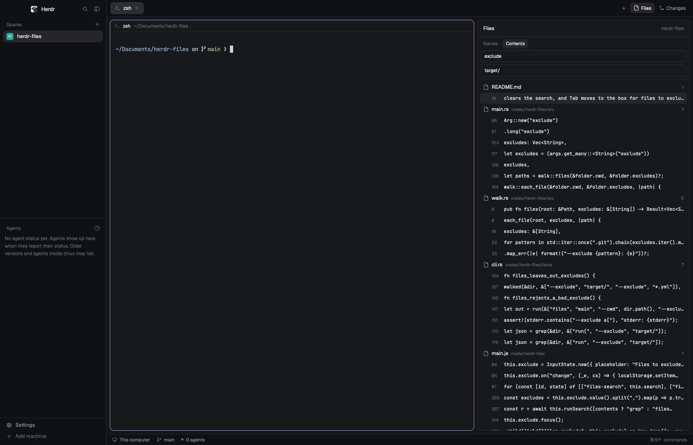

# herdr-files

herdr-files adds a search box and path copy to the Files pane of
[Herdr](https://herdr.dev).



- Type parts of a path, as in fzf, to find files by name. The best matches
  come first. Add `:42` or `:42:5` to open the file at that line and column.
- Switch from Names to Contents to search inside the files. Matching lines
  are grouped by file, and clicking one opens the file at that line. A
  search stops after 5 seconds and shows what it has found so far.
- To leave files out, type gitignore-style patterns such as
  `target/, *.log` in the box under the search box.
- Right-click a file or folder and choose Copy absolute path or Copy
  relative path. The relative path starts at the Files pane's folder.

Cmd-Shift-F (Super-Shift-F on Linux) opens the Files pane with the cursor
in the search box. Press it again there to switch between Names and
Contents. Up and Down move through the results, Enter opens one, Escape
clears the search, and Tab moves to the box for files to exclude.

It runs on macOS with Apple silicon and on Linux (x64 and arm64). To search
in a space on another machine, that machine needs the program too; see
[Search on other machines](#search-on-other-machines).

## Install

Each release has two parts: the mod, which draws the Files pane, and the
`herdr-files` program, which the mod runs to search. The mod starts the
program with Herdr's `exec` and reads the files in the folder the Files
pane shows, and neither of them connects to the network.

If you would rather not do this by hand, ask an agent in Herdr to install
herdr-files by following this README.

### 1. Get the mod and the program

Run the blocks below one after another in the same terminal. The first
finds Herdr's folder and downloads the release into a new temporary folder:

```sh
home="${HERDR_APP_HOME:-${XDG_CONFIG_HOME:-$HOME/.config}/herdr-app}"
case "$(uname -sm)" in
  "Darwin arm64") target=aarch64-apple-darwin ;;
  "Linux x86_64") target=x86_64-unknown-linux-musl ;;
  "Linux aarch64") target=aarch64-unknown-linux-musl ;;
esac
cd "$(mktemp -d)"
url=https://github.com/kos-369/herdr-files/releases/latest/download
curl -fsSL --remote-name-all "$url/herdr-files-mod.tar.gz" "$url/herdr-files-$target.tar.gz"
```

To check the downloads, run this next. You can skip it. On Linux without
`shasum`, use `sha256sum -c --ignore-missing SHA256SUMS` instead. `gh` is
the [GitHub CLI](https://cli.github.com).

```sh
curl -fsSLO "$url/SHA256SUMS"
shasum -a 256 -c --ignore-missing SHA256SUMS
gh attestation verify herdr-files-mod.tar.gz --repo kos-369/herdr-files
gh attestation verify "herdr-files-$target.tar.gz" --repo kos-369/herdr-files
```

Then put the mod in Herdr's `mods/` folder and the program in the mod's
`bin/` folder, and go back to the folder you were in:

```sh
tar -xzf herdr-files-mod.tar.gz -C "$home/mods"
mkdir -p "$home/mods/herdr-files/bin"
tar -xzf "herdr-files-$target.tar.gz" -C "$home/mods/herdr-files/bin" herdr-files
cd -
```

On macOS, download with curl as above. macOS may refuse to run a program
that a browser downloaded until you remove its quarantine flag:
`xattr -d com.apple.quarantine <path to herdr-files>`.

There is no release build for Intel Macs. To build the program yourself,
install [Rust](https://rustup.rs) and run the command below, with `v0.1.2`
changed to the tag of the release the mod came from:

```sh
cargo install --locked --git https://github.com/kos-369/herdr-files --tag v0.1.2 herdr-files
```

The mod looks for the program in its `bin/` folder first and then on your
`PATH`. If Herdr does not find `~/.cargo/bin`, copy the program into the
`bin/` folder.

### 2. Add the shortcut

Open `keys.json` in Herdr's folder. On macOS, run this in the terminal
from step 1, where `$home` is that folder (`~/.config/herdr-app` unless
you moved it); it opens the file in TextEdit. On Linux, open it in any
text editor.

```sh
open -e "$home/keys.json"
```

Near the top is the line `"global": {`. Add this line right under it, with
the comma at the end, and save. Paste it instead of typing it, so the
quotes stay straight. Herdr reads the file as soon as it is saved.

```json
    "cmd-shift-f": "mod.open:herdr-files",
```

On Linux, `cmd` is the Super key. While `keys.json` stays unedited, Herdr
adds new default shortcuts to it. After you edit it, you have to add them
yourself.

### 3. Use it in your layout

Herdr's own layouts are read-only, so clone the one you use (`main` is the
default). This command, or Duplicate layout in the command palette, makes
the clone and switches to it:

```sh
herdr-app do layout.clone '{"name":"main","as":"my-layout"}'
```

Then open the clone the same way as `keys.json`:

```sh
open -e "$home/layouts/my-layout.json"
```

Search it (Cmd-F) for `"id": "files"`. A few lines below is
`"mod": "files"`. Change it to `"mod": "herdr-files"` and save; the Files
pane changes at once. If you already use a layout of your own, change that
one instead.

### 4. Check it

Press Cmd-Shift-F and type part of a file name. If the Files pane says
"Search needs the herdr-files program", the program is not in
`mods/herdr-files/bin/` or on your `PATH`.

### Search on other machines

In a space on another machine, the Files pane runs the `herdr-files`
program on that machine. It looks for it on the `PATH` of Herdr's core
there, then in `~/.local/bin`. To put it in `~/.local/bin`, open a terminal
in a space on that machine and run:

```sh
case "$(uname -sm)" in
  "Darwin arm64") target=aarch64-apple-darwin ;;
  "Linux x86_64") target=x86_64-unknown-linux-musl ;;
  "Linux aarch64") target=aarch64-unknown-linux-musl ;;
esac
mkdir -p ~/.local/bin
curl -fsSL "https://github.com/kos-369/herdr-files/releases/latest/download/herdr-files-$target.tar.gz" | tar -xzf - -C ~/.local/bin herdr-files
```

To check the download first, download the file and `SHA256SUMS` and check
them as in step 1. The Files pane says "Search on <machine> needs the
herdr-files program there" while the machine doesn't have it.

### Update or remove

To update, run step 1 again, and the command above on each other machine.
To remove herdr-files, change `"mod"` in your layout back to `"files"`,
delete the shortcut, and delete `mods/herdr-files/` and
`~/.local/bin/herdr-files` on other machines.

## Contributing

See [CONTRIBUTING.md](CONTRIBUTING.md). To report a vulnerability, see
[SECURITY.md](SECURITY.md).

## License

Apache-2.0. See [LICENSE](LICENSE) and [NOTICE](NOTICE). NOTICE also lists
the code from other projects that the program and the mod include.
