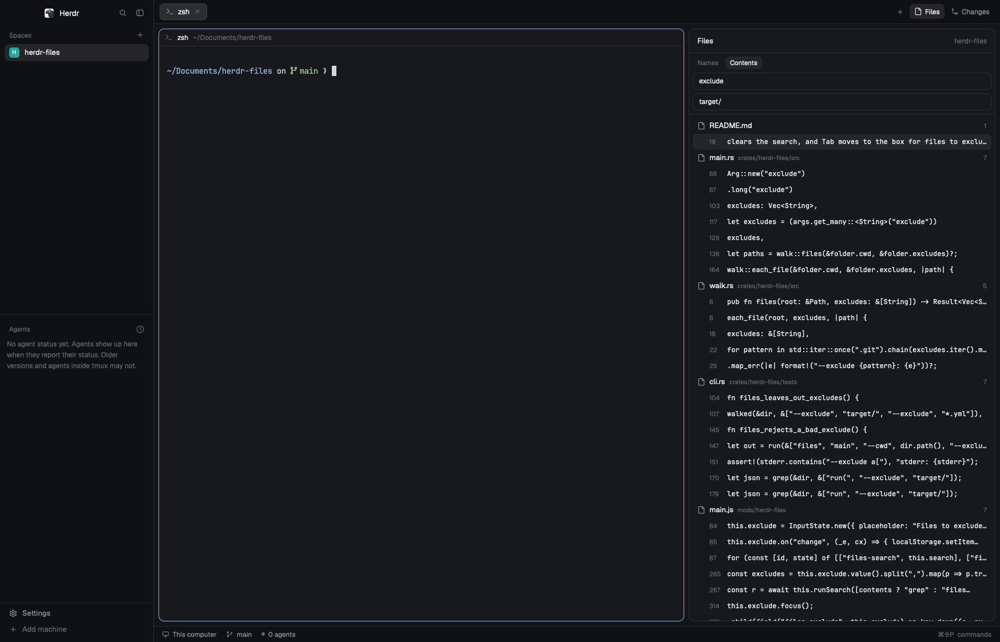

# herdr-files

Herdr's Files pane with a search box on top. Type part of a path to find
files by name, best match first, or switch to Contents to find lines inside
the files, grouped by file. Clicking a result opens it in the pane's
preview, at the matching line when there is one. A second box leaves files
out with gitignore-style patterns. Right-clicking a file or folder copies
its absolute or relative path. Cmd-Shift-F shows the pane with the cursor in
the search box.

## What you see

One column that fills its block: `background`, radius 10, 1px `border`,
13px `foreground` text. Top to bottom:

- **Header**, 42px, 14px side padding, bottom `border`. "Files" in
  semibold, then on the right the last part of the folder's path at 12px
  `dim`. While a file is open, a `←` (20px wide, `muted`) comes first and
  the right side shows the file's path.
- **Search area**, hidden while a file is open. 6px padding, 6px gaps,
  bottom `border`:
  - Two mode tabs, "Names" and "Contents": 22px tall, 8px side padding,
    radius 6, 11.5px. The selected one has `foreground` text on a `hover`
    background; the other is `dim` and turns `foreground` on hover.
  - The search box: 30px tall, 10px side padding, radius 8, 1px border in
    `accent` while it has the cursor, else `border`, 12px text, placeholder
    "Search files".
  - The exclude box, the same, placeholder "Files to exclude, e.g. target/,
    \*.log".
- **While the search box is empty**, the file tree of Herdr's own Files
  mod: 6px padding, 28px rows with radius 7 and `hover` on hover, indented
  8px plus 18px per level. A folder row has a 12px chevron in `dim` (right
  when closed, down when open), then a 14px folder icon in `muted`; a file
  row has a 12px gap, then a 14px file icon. The name follows, and on the
  right Git's mark at 11px: `A` (new or untracked) in `ansi2`, `D` or `U`
  in `ansi1`, `M` in `blocked`. Folders come before files, each sorted by
  name.
  `.git` is left out. Under the rows, 12px `dim` text says "Loading
  files…", "No files", "No folder" or the error.
- **While the search box has text**, the results instead of the tree:
  - Names: 28px rows, radius 7, 8px side padding: a 14px file icon, the
    file's name, then its folder at 11px `dim`. The selected row has
    `hover`.
  - Contents: for each file, a file row as in Names with the number of
    matching lines on the right at 11px `dim`, then one row per line,
    indented 29px: the line number at 11px `dim` (at least 24px wide) and
    the line's text at 12px in the terminal font (`settings().font_family`),
    leading spaces trimmed.
  - Instead of rows, 12px `dim` text: "Searching…", "No matching files",
    "No matching lines", "Search works only for folders on this computer",
    or the program's error.
  - Under the list, at 11px `dim`, when the list was cut: "Showing the
    best N matches" (Names), "Showing the first N lines" (Contents) or
    "Stopped after 5 s · N lines found".
  - When the `herdr-files` program can't be found, 12px `dim` text with
    14px padding: "Search needs the herdr-files program.", "Put it in
    ~/.config/herdr-app/mods/herdr-files/bin/ or on your PATH." (the real
    Herdr folder, with the home folder as `~`), then two links in `accent`,
    `foreground` on hover: "Copy folder path" and "How to install".
- **An open file**: a read-only editor, 12px in the terminal font, with
  syntax colors: keywords `ansi5`, strings `ansi2`, comments `dim`,
  functions `ansi4`, types `ansi3`, numbers `ansi1`, constants `ansi6`.
  "Loading file…", "Binary file · no text preview", "This file is no
  longer available" or "Cannot preview this file (binary, too large, or
  unreadable)" instead, in `dim`.
- **The right-click menu**: a 220px popup at the pointer on `popover`, 5px
  padding, 12.8px text. The path at 11px `dim`, then "Copy absolute path"
  and "Copy relative path", 31px rows with radius 7 and `hover` on hover.

## How it behaves

- The folder is the focused terminal's folder, else the space's folder. The
  tree reloads every 10 seconds, and at once when a folder on this computer
  changes on disk. It remembers which folders were open, and the open file,
  for each folder it has shown.
- Clicking a folder opens or closes it. Clicking a file opens it in the
  preview; `←` goes back to the tree or the results.
- Typing in the search box searches 150ms after the last key. One search
  runs at a time; while it runs, only the newest query waits.
- Names: the words are matched against the whole path as in fzf, best
  match first, up to 200 files. A word with an upper-case letter is case
  sensitive. A trailing `:42` selects line 42 when a result opens, and
  `:42:5` puts the cursor at line 42, column 5. Neither is part of the
  search.
- Contents: the text is found as typed, case ignored, up to 200 lines.
  The search stops after 5 seconds and shows what it found. The first
  matching line is selected, under the first file's row.
- Up and Down move through the results and skip file rows. Enter opens the
  selected result, and a click opens the one clicked. A file opens at the
  top, or at the line typed after the words; a matching line opens at that
  line. Escape clears the search box when it has text.
- The exclude box takes comma-separated gitignore-style patterns, such as
  `target/, *.log`. Changing it runs the search again. It is kept across
  restarts.
- Cmd-Shift-F shows the pane, opening the layout nodes and stack tab it is
  in, closes a preview, puts the cursor in the search box and selects the
  text there. Pressed again while the cursor is in the search box, it
  switches Names and Contents and keeps the text. Clicking a tab switches
  too.
- Tab in the search box moves to the exclude box; Shift-Tab there moves
  back.
- Right-click a file or folder, in the tree only, then choose one of the two
  items. The path goes to the clipboard and a "Copied path" toast shows it.
  The relative path starts at the pane's folder.
- In a space on another machine the tree works, and search shows "Search
  works only for folders on this computer".

## Built from

- `mods/herdr-files/` began as a copy of Herdr 0.1.16's `files` mod
  (`mod.clone`). The tree, the preview, the Git marks and the folder
  listing are that mod's code.
- `mod.json`: `"place": "none"`, and an `overlay` of kind `window`, 1 by 1,
  with props `{ "launch": true }`. The layout puts the pane in by setting
  the `files` block's `content.mod` to `herdr-files`.
- One mod, three roles chosen by `props()`:
  - none: the pane.
  - `launch`: what `mod.open:herdr-files` opens. It finds the block whose
    `content.mod` is `herdr-files` in `layout()`, runs `layout.show` on each
    node above it and `layout.select` on each stack, sets
    `setShared("herdr-files.search", Date.now())` and closes itself. The
    pane sees the new value in `render` and focuses its search box.
  - `menu: { root, on, path }`: the right-click popup, opened with
    `openOverlay({ kind: "popup", at: "pointer", width: 220 })`.
- `herdr`: `spaces`, `panes`, `focused`, `exec`, `readTextFile`,
  `watchFolder`, `theme`, `settings`, `window`, `props`, `openOverlay`,
  `closeOverlay`, `notify`, `appHome`, `home`, `layout`, `run`, `shared`,
  `setShared`. `gpui-base`: `InputState`, `Input`, `Editor`, `EditorState`,
  `v_virtual_list`, `VirtualListScrollHandle`, `Scrollbar`. The exclude
  patterns are kept in `localStorage` under `exclude`.
- Programs it runs with `exec`: `sh` to list a folder (PowerShell on
  Windows), `git rev-parse` and `git status` for the marks, and the
  `herdr-files` program for search. It tries
  `<appHome()>/mods/herdr-files/bin/herdr-files`, then `herdr-files` on
  `PATH`, and remembers the one that ran. A "No such file or directory"
  error from both means the program is missing. Search calls `exec`
  without `on`, so it runs only on this computer.
- The `herdr-files` program is a Rust CLI in `crates/herdr-files/` (crates
  `clap`, `ignore`, `nucleo-matcher`, `regex`, `serde_json`):
  - `herdr-files files --cwd DIR [--exclude PATTERN]... -- QUERY` prints
    `{"line", "column", "results": [{"path", "score"}], "truncated"}`.
  - `herdr-files grep --cwd DIR [--exclude PATTERN]... --timeout 5000 --
    TEXT` prints `{"results": [{"path", "line", "column", "text"}],
    "timed_out", "truncated"}`, in path order, one hit per line.
  - Both walk every file, hidden and gitignored ones too, except `.git` and
    the excludes, and print at most 200 results. `grep` skips binary files
    and keeps up to 200 characters of a long line around the match.
- Art: Lucide's `chevron-down`, `chevron-right`, `file` and `folder` SVGs
  (`LICENSE-Lucide.txt`).
- `keys.json`: `{"global": {"cmd-shift-f": "mod.open:herdr-files"}}`. On
  Linux, `cmd` is the Super key.

## Watch out

- Copying `mods/herdr-files/` doesn't bring the program. The README's
  Install section (https://github.com/kos-369/herdr-files#install) gets it
  from the latest release, which has builds for macOS on Apple silicon and
  Linux on x64 and arm64; elsewhere, build it with `cargo install`. Without
  it the tree and the path copy still work, and search shows the help above.
- Herdr's own layouts are read-only and a mod with `"place": "none"` is not
  added on its own: clone the layout and change its `files` block.
- Tab: right after Herdr starts, Herdr binds Tab to "focus the next field"
  around every mod, and that binding runs before the mod's `on_key_down`.
  The binding goes away the next time Herdr loads `keys.json` (when the
  file changes), and from then on Tab reaches the mod. So the mod moves the
  focus on Tab itself too, and Tab can't do anything else in the search
  box.
- The shortcut's overlay must be kind `window`. A `popup` takes the
  keyboard while it is open and gives it to the terminal when it closes, so
  the terminal has the focus for a moment.
- When the pane sees the new `herdr-files.search` value in `render`, the
  search box's `focus` and `blur` events still show where the cursor was
  before the shortcut, so the pane can tell a second press from the first.
- Switch modes in `cx.timer.after(0, …)`, not in `render`: emptying the
  results while the list draws them shows Herdr's red error bar.
- Limits: 500 entries per folder and 5,000 in all in the tree, with a note
  under it; 200 search results; 5 seconds for Contents; 400,000 characters
  of a file in the preview, then "… (file truncated)".

## Done when

- `herdr-app check mods/herdr-files` passes.
- With the pane in the layout and the program in `bin/`, Cmd-Shift-F shows
  the Files pane with the cursor in the search box.
- Typing a file's name followed by `:18` lists that file first, and Enter
  opens it with line 18 selected.
- Cmd-Shift-F again switches to Contents and keeps the cursor in the
  search box. Typing a word that several files contain lists those files
  with a count each and their lines under them, and clicking a line opens
  the file at that line.
- Typing a folder's name with a trailing `/` in the exclude box drops every
  result under that folder.
- Tab moves from the search box to the exclude box and Shift-Tab back, both
  right after Herdr starts and after `keys.json` is saved again.
- Right-clicking a file inside an open subfolder and choosing Copy relative
  path puts `subfolder/file` on the clipboard, and Copy absolute path the
  full path.
- With the program moved out of `bin/` and not on `PATH`, typing in the
  search box shows "Search needs the herdr-files program.", and How to
  install opens the README's Install section.
